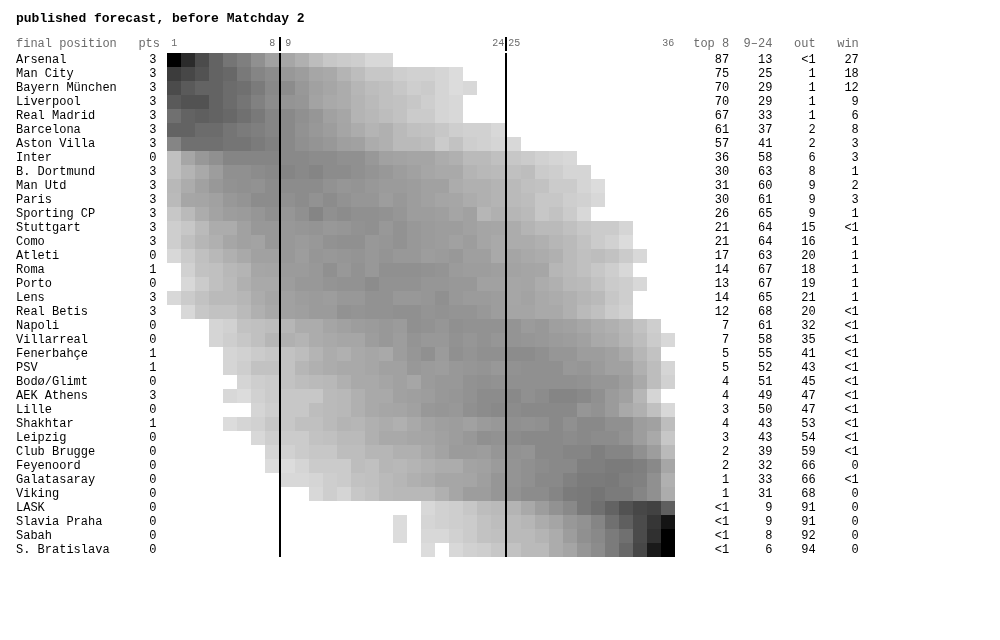

# cutline

The 2026-27 Champions League, simulated 10,000 times after every matchday.



**Live: [iliev-blnk.github.io/cutline](https://iliev-blnk.github.io/cutline/)**

Each row is a club and each column a final league-phase position; darker means more likely. The
two lines are the cuts that decide the new format: top 8 go straight to the round of 16, 9–24 play
a knockout play-off, 25–36 are out. Click any upcoming match and set a score to see what changes.
The same 10,000 seasons re-run in your browser in about a second.

## How it works

- **Data.** Every UEFA club competition match since July 2021 (UEFA's public match data) and
  every top-division match in 18 European leagues (football-data.co.uk): about 32,000 matches.
- **Model.** Hierarchical Dixon–Coles. Each club has an attack and a defence (its country's level
  plus its own deviation), each domestic league has a goal level, and European matches link the
  leagues. Matches lose half their weight after a year.
- **Uncertainty.** Each club's strength comes with a standard error (Laplace approximation), and
  every simulated season draws its own strengths from it.
- **Simulation (TypeScript).** Samples every unplayed league-phase match, ranks with UEFA's full
  tiebreaker list, then plays the seeded knockout bracket with two legs, extra time, penalties
  and a neutral final. The table code reproduces the official 2024-25 and 2025-26 tables
  exactly. The same engine runs in Node for snapshots and in a Web Worker for "what if".

## Does it work?

Settings were tuned on 2023-24 only, pinned in the code, then scored once on 2024-25 and 2025-26
([full report](research/REPORT.md)):

| ranked probability score (lower is better) | model | Elo | base rates | betting market |
| --- | ---: | ---: | ---: | ---: |
| 558 Champions League matches | **0.197** | 0.217 | 0.235 | – |
| 10,231 domestic matches | 0.205 | 0.205 | 0.230 | **0.198** |

- The model clearly beats Elo in European matches.
- The betting market beats the model in domestic matches. Closing odds know about injuries and
  line-ups; the model only sees results.
- For whole-season questions (Brier score), the model beats Elo at "top 8" and "reaches the
  quarter-finals" and is slightly behind it at the 24th-place cut.
- No method beat "every club equal" at picking the eventual winner in these two seasons.

## The record

Every prediction is committed to [`predictions/2027/`](predictions/2027/) before the next matchday
kicks off, and the commit time is the proof. A GitHub Action refits and re-simulates every morning
and commits a snapshot only between matchdays. [The record page](https://iliev-blnk.github.io/cutline/record.html)
scores each one against what happened. The first snapshot (before Matchday 2) was published
before the backtest, with untuned defaults, and says so.

## Run it

```sh
python -m venv model/.venv && model/.venv/bin/pip install -e "model[dev]"
pnpm install
model/.venv/bin/cutline ingest                 # download sources → data/
model/.venv/bin/cutline snapshot --force       # fit + 10,000 seasons → predictions/2027/
model/.venv/bin/cutline backtest tune|test     # research/
pnpm --dir site dev                            # the page
model/.venv/bin/pytest model && pnpm -r test   # tests
```

Optional: set `ODDS_API_KEY` (free tier of the-odds-api.com) as a repository secret to record
bookmaker odds for each matchday and score the model against the market live.

Data: UEFA public match data, [football-data.co.uk](https://www.football-data.co.uk/). MIT licence.
