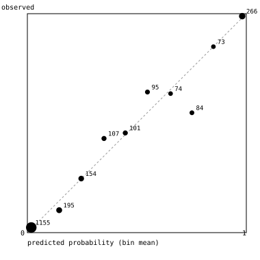

# cutline backtest

Does the goals model predict the Champions League better than simple baselines, and are its
season-long probabilities honest? Settings were chosen on one season and the model was then scored
once on the next two. All numbers come from `cutline backtest test` (`research/test.json`); the
tuning table is `research/tune.csv`.

## Protocol

- **Tuning, 2023-24.** Every match of the season (domestic + UEFA, 5,936 matches). The model is
  refit at the start of each month and predicts that month. The best mean RPS chose
  half-life 365 days, λ_team 3, λ_country 0.03. The first grid put λ_team at its edge (3), so it
  was extended to 10 and 30 on the same tuning season; 3 stayed best. The values were pinned in
  `model/cutline/fit.py` and committed (99e0b35) before the test seasons were scored.
- **Test, 2024-25 and 2025-26, run once.** Same monthly refits, no changes afterwards.
- **xG was not tested.** football-data.co.uk only has xG from August 2026, so there is no past
  season to tune or test it on.
- **Baselines:**
  - **Elo:** World Football Elo, K = 20, home +60, on the same matches. A Poisson regression on
    the rating difference turns ratings into goals, so the same simulator can run it.
  - **Base rates:** each league's home/draw/away frequencies over the previous three years.
  - **Market:** closing odds with the margin removed proportionally (Pinnacle where available,
    otherwise the market average). This exists for domestic matches only; there is no free
    historical source for Champions League odds.
- **Scores:**
  - **RPS:** ranked probability score per match, 0 is perfect, and saying 1/3 each scores
    ≈ 0.22. Lower is better.
  - **Log loss.**
  - **Brier score** for season outcomes.
  - Every method is scored on the same matches.

## Match level

| | n | model | Elo | base rates | market |
| --- | ---: | ---: | ---: | ---: | ---: |
| Champions League, RPS | 558 | **0.1972** | 0.2174 | 0.2354 | – |
| Champions League, log loss | 558 | **0.914** | 0.980 | 1.024 | – |
| All UEFA competitions, RPS | 1,830 | **0.2023** | 0.2164 | 0.2317 | – |
| Domestic leagues, RPS | 10,231 | 0.2046 | 0.2052 | 0.2297 | **0.1979** |
| Domestic leagues, log loss | 10,231 | 1.001 | 1.004 | 1.075 | **0.980** |

Per season (RPS):

| | Champions League: model | Elo | domestic: model | Elo | market |
| --- | ---: | ---: | ---: | ---: | ---: |
| 2024-25 | 0.1988 | 0.2206 | 0.2039 | 0.2042 | 0.1968 |
| 2025-26 | 0.1955 | 0.2141 | 0.2053 | 0.2063 | 0.1991 |

- In European matches the model is clearly better than Elo, in both seasons. That is where the
  country structure matters: Elo has to learn how strong the Portuguese or Norwegian league is
  from a few European results, while the model gets each club's strength relative to its
  league from hundreds of domestic matches.
- In domestic matches the model is only marginally better than Elo, and **the betting market
  beats both** (0.198 vs 0.205). This is expected: closing odds include team news, injuries and
  line-ups, which the model never sees. On a site that compares itself with the market, this is
  the number to keep in mind.

## Season outcomes (league phase)

Before each of the 8 league-phase matchdays of both seasons, the model was fit on data up to that
kickoff and the season was simulated 10,000 times. The same was done with the Elo model, and with
every club equal (only the schedule and luck vary). That gives 16 cutoffs × 36 clubs = 576
forecasts per event. Brier score, lower is better:

| event | model | Elo | all clubs equal |
| --- | ---: | ---: | ---: |
| finishes top 8 | **0.103** | 0.127 | 0.132 |
| finishes top 24 | 0.105 | **0.101** | 0.130 |
| reaches the quarter-finals | **0.111** | 0.132 | 0.144 |
| wins the competition | 0.029 | 0.030 | **0.027** |

- The model is best for the top 8 and the quarter-finals.
- Elo is slightly better at the 24th-place cut.
- **Nobody beats "every club equal" for the winner.** Both winners in these seasons
  (league-phase ranks 15 and 11) were not favourites. Forecasts that put a quarter on the
  favourite are punished by Brier when the favourite loses. Two winners is far too few to read
  anything into, in either direction.

Reliability (model; all four events pooled over the 16 cutoffs):

| predicted (bin) | n | mean predicted | observed |
| --- | ---: | ---: | ---: |
| 0–10% | 1,155 | 1.8% | 2.3% |
| 10–20% | 195 | 14.5% | 10.3% |
| 20–30% | 154 | 24.6% | 24.7% |
| 30–40% | 107 | 35.0% | 43.0% |
| 40–50% | 101 | 44.7% | 45.5% |
| 50–60% | 95 | 54.9% | 64.2% |
| 60–70% | 74 | 65.4% | 63.5% |
| 70–80% | 84 | 75.1% | 54.8% |
| 80–90% | 73 | 85.0% | 84.9% |
| 90–100% | 266 | 98.1% | 98.9% |

Mostly close to the diagonal. The 70–80% bin is the clear miss: 55% observed. The forecasts within
a season are strongly correlated (the same club appears at every cutoff), so these 2,304 points
are worth far fewer independent observations than they look.

## Limits

- Two seasons of the new format, 72 club-seasons: a small sample for calibration.
- No injuries, suspensions, transfers or line-ups. The market's edge in domestic matches is the
  measure of what that costs.
- The time weighting is the only in-season form signal.
- Penalty shoot-outs are 50/50.
- The 2026-27 snapshot before Matchday 2 was published with untuned defaults (half-life 365,
  λ_team 1, λ_country 0.1; tuning RPS 0.1985 vs 0.1980 tuned). Later snapshots use the tuned
  values.
